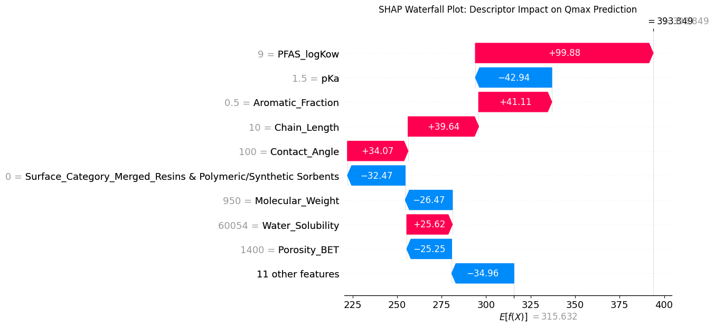

# Predicting PFAS Adsorption Capacity on Diverse Sorbents with Ensemble Machine Learning

Stacked ensemble models (XGBoost, Random Forest, linear base learners) that predict the maximum adsorption capacity (Qmax, mg/g) of per- and polyfluoroalkyl substances (PFAS) on activated carbons, resins, MOFs, COFs, clays and other sorbents from molecular and surface descriptors. Includes SHAP explanations and an interactive predictor.



## Highlights

- **Literature-curated dataset:** 2,438 adsorption records covering 77 unique PFAS and 8 sorbent surface categories, each linked to a source DOI.
- **Two tasks:** regression of Qmax and classification of high (Qmax > 500 mg/g) versus low adsorption.
- **Stacking ensembles:** XGBoost, Random Forest and linear models as base learners with a gradient boosting meta learner.
- **Explainable:** SHAP waterfall plots show which descriptors push a prediction up or down.
- **Interactive predictor:** enter descriptors and a surface type, get a Qmax estimate, a High/Low label, and the closest PFAS match from PubChem.

## Results (20% held-out test set, random split)

| Task | Metric | Value |
|---|---|---|
| Regression (Qmax) | MAE | 210.05 mg/g |
| Regression (Qmax) | R² | 0.237 |
| Classification (Qmax > 500 mg/g) | Accuracy | 0.884 |
| Classification | F1, low class (275 samples) | 0.93 |
| Classification | F1, high class (44 samples) | 0.59 |

The classifier separates low from high adsorption well overall, but the high-capacity class is small and harder to catch (precision 0.57, recall 0.61). Qmax is heavy tailed (mean about 306 mg/g, maximum 44,410 mg/g), which limits the regression R². Treat these as baseline numbers.

## Method

1. **Cleaning:** normalize surface names into 9 categories, convert descriptors to numeric, drop rows without Qmax (1,593 usable rows), median-impute missing descriptors.
2. **Features (20):** chain length, hydrogen bond acceptor count, rotatable bonds, molecular weight, aromatic fraction, contact angle, BET porosity, logKow, pKa, water solubility, IEP, plus one-hot encoded surface category.
3. **Models:** `StackingRegressor` and `StackingClassifier` (XGBoost + Random Forest + Linear/Logistic Regression, gradient boosting meta learner), plus standalone XGBoost models used by the interactive predictor.
4. **Interpretation:** SHAP `TreeExplainer` waterfall plots for any user-entered sample.

## Repository structure

```
.
├── data/PFAS_Dataset_2500.xlsx
├── notebooks/pfas_ensemble_qmax_prediction.ipynb
├── figures/shap_waterfall_example.png
├── requirements.txt
└── LICENSE
```

## Getting started

```bash
git clone https://github.com/AnandTumuluri/pfas-adsorption-ensemble-ml.git
cd pfas-adsorption-ensemble-ml
pip install -r requirements.txt
jupyter notebook notebooks/pfas_ensemble_qmax_prediction.ipynb
```

Run the notebook from the `notebooks/` folder so the data path resolves. The last cell asks for descriptor values and needs internet access for the PubChem lookup. Trained models are saved as `.pkl` files and are not tracked in git.

## Dataset

`PFAS_Dataset_2500.xlsx` has a `Data` sheet (one row per adsorption measurement, with molecular descriptors, surface properties, experimental conditions, Qmax and the source DOI), a cleaned `Main` sheet, and notes on kinetic, diffusion and isotherm models. The data were compiled from published studies; please cite the original papers (DOIs are in the `doi` column) when reusing it.

## Limitations and future work

- Random train/test split: measurements from the same study or PFAS can appear in both sets. Grouped splits by DOI or by PFAS molecule would give a stricter estimate.
- Experimental conditions (pH, temperature, concentration) are not yet model inputs.
- Heavy-tailed target: log-transforming Qmax and handling outliers should help regression.
- The reported numbers come from an earlier 2,000-row version of the dataset, so results may shift on the current file.

## Author

Poornanand Tumuluri, University at Buffalo

## License

MIT
